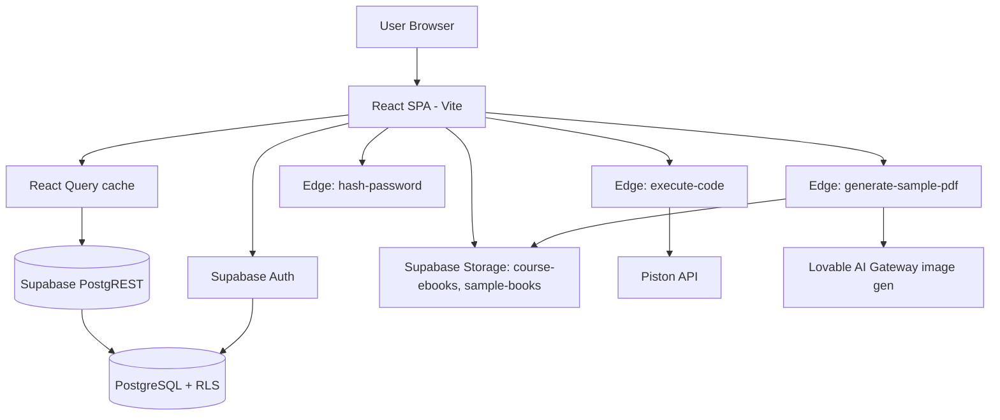
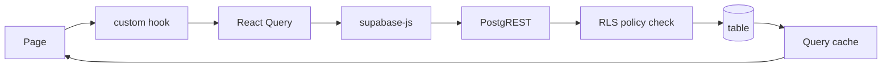
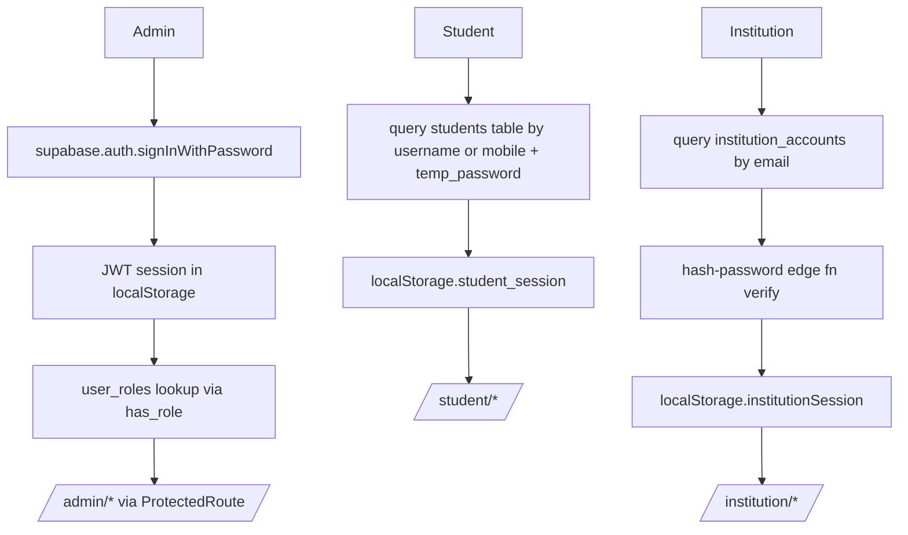
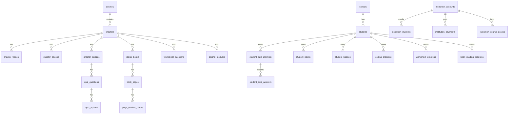

# PROJECT KNOWLEDGE BASE — KodeIntel

> Generated by static analysis of the current codebase. Facts here are derived from actual files.
> Where something could not be determined, it is marked **Not identifiable from the current codebase.**

---

## 1. PROJECT OVERVIEW

### Project at a Glance

| Item | Value |
|---|---|
| Project name | `kode-intel` (package.json), branded **KodeIntel** |
| Type | Client-side Single Page Application (SPA) + Supabase backend (BaaS) |
| Purpose | AI & Computational Thinking learning platform for school students, Classes 3–10 |
| Frontend | React 18.3 + TypeScript 5.8 + Vite 5.4 |
| Styling | Tailwind CSS 3.4 + shadcn/ui (Radix primitives) |
| Backend | Supabase (Postgres, Auth, Storage, Edge Functions) |
| Database | PostgreSQL (Supabase), RLS enabled |
| Auth | Three parallel systems: Supabase Auth (admin), custom table-based (students), custom table-based + hashed password edge function (institutions) |
| Payments | None integrated in code (institution payments are recorded manually in `institution_payments`) |
| Deployment | Lovable hosting. Published: `https://admin-owl-school.lovable.app`; custom domains `kodeintel.com`, `www.kodeintel.com` |
| Package manager | npm (package.json / `npm i`); bun lockfile not present in listing |

### Problem it solves
Schools and individual learners in India lack a structured, NEP-2020-aligned digital curriculum for AI and computational thinking for Classes 3–10. KodeIntel delivers a digital-only LMS: digital books, YouTube video lessons, auto-graded quizzes, interactive worksheets, and a Blockly-based coding lab, plus admin/institution management tooling.

### Target users
1. **Students (school-provided)** — credentials issued in bulk by an admin.
2. **Students (individual)** — self signup with mobile number, trial-based access.
3. **Guests** — trial visitors browsing content without a persistent account (`/guest`).
4. **Institutions** — schools/coaching/corporate managing their own students.
5. **Super Admin / Admin** — content and platform management under `/admin/*`.

### Main features
- Course → Chapter → (Videos | Quizzes | eBooks | Digital Book | Worksheet | Coding Module) content tree
- Digital Book reader with typed content blocks and a Sample Book viewer with TOC + PDF download
- Server-generated, illustrated sample-book PDFs (Supabase Edge Function + Storage)
- Blockly Code Lab (block coding) with class-specific themes/toolboxes + a multi-language code compiler (Piston API)
- Interactive worksheets (fill-blank, true/false, match column, short answer, ordering, block reasoning)
- Quizzes with attempts, answers, pass/fail scoring
- Gamification: points, levels, streaks, badges, achievements, leaderboards
- Guest trial mode with localStorage progress
- Admin: schools CRUD, students CRUD + CSV/Excel bulk upload, course editor, quiz builder, coding module manager
- Institution portal: students, courses, reports, payments, settings
- Marketing site: Landing, Courses, Course Detail, About, School Partnership, Contact

### Major user flows
Guest trial → class selection → chapter → content; Student login → dashboard → chapter modules → progress/gamification; Institution signup/login → dashboard; Admin login (Supabase Auth) → `/admin` dashboard → content management.

### External services
| Service | Use |
|---|---|
| Supabase | DB, Auth, Storage, Edge Functions |
| Lovable AI Gateway (`LOVABLE_API_KEY`) | AI image generation inside the PDF edge function |
| Piston API (`emkc.org/api/v2/piston/execute`) | Remote code execution for the compiler |
| YouTube | All video hosting (URLs stored in `chapter_videos.youtube_url`) |
| Google Fonts | Nunito, Baloo 2, Space Mono |

---

## 2. TECHNOLOGY STACK

### Languages
- **TypeScript 5.8.3** — all app code (`src/**/*.ts`, `*.tsx`)
- **TypeScript / Deno** — Supabase Edge Functions (`supabase/functions/**`)
- **SQL** — migrations in `supabase/migrations/`
- **CSS** — `src/index.css`, `src/App.css`

### Core frameworks & libraries (from `package.json`)

| Package | Version | Purpose / Where used |
|---|---|---|
| `react`, `react-dom` | ^18.3.1 | UI runtime, all of `src/` |
| `vite` | ^5.4.19 | Dev server + bundler (`vite.config.ts`) |
| `@vitejs/plugin-react-swc` | ^3.11.0 | Fast React transform |
| `react-router-dom` | ^6.30.1 | Routing in `src/App.tsx` |
| `@tanstack/react-query` | ^5.83.0 | Server state/caching (`src/hooks/useCourses.ts`, `useSchools.ts`, `useStudents.ts`) |
| `@supabase/supabase-js` | ^2.89.0 | DB/auth/storage/function client (`src/integrations/supabase/client.ts`) |
| `tailwindcss` | ^3.4.17 | Styling; config `tailwind.config.ts` |
| `tailwindcss-animate`, `@tailwindcss/typography` | ^1.0.7 / ^0.5.16 | Animation utilities, prose styles |
| `@radix-ui/*` (25 packages) | various | Primitives behind `src/components/ui/*` (shadcn/ui) |
| `lucide-react` | ^0.462.0 | All icons (project rule: icons, not emojis) |
| `class-variance-authority`, `clsx`, `tailwind-merge` | — | Variant + class merging (`src/lib/utils.ts`) |
| `sonner` | ^1.7.4 | Toast notifications (`Sonner` in App.tsx) |
| `react-hook-form` + `@hookform/resolvers` + `zod` | ^7.61.1 / ^3.10.0 / ^3.25.76 | Form handling & schema validation (`src/components/ui/form.tsx`, `src/pages/Auth.tsx`) |
| `blockly` | ^12.3.1 | Block coding lab (`src/lib/blockly/*`, `src/hooks/useBlockly.ts`) |
| `@uiw/react-codemirror` + `@codemirror/lang-{cpp,java,javascript,python}` + `@uiw/codemirror-theme-vscode` | ^4.25.x / ^6.x | Text-code editor in `src/pages/student/Compiler.tsx` |
| `react-pdf` | ^9.2.1 | PDF preview (`src/components/student/GuestPdfPreview.tsx`) |
| `recharts` | ^2.15.4 | Charts (`src/components/ui/chart.tsx`, dashboards) |
| `embla-carousel-react` | ^8.6.0 | Carousels (mobile badges/fun-facts) |
| `date-fns` | ^3.6.0 | Date formatting |
| `next-themes` | ^0.3.0 | Theme provider plumbing for Sonner |
| `vaul` | ^0.9.9 | Drawer component |
| `cmdk` | ^1.1.1 | Command palette component |
| `react-day-picker` | ^8.10.1 | Calendar component |
| `react-resizable-panels` | ^2.1.9 | Resizable panels (code lab layout) |
| `input-otp` | ^1.4.2 | OTP input component |

### Dev dependencies
`eslint` ^9.32.0 + `typescript-eslint` ^8.38.0 + `eslint-plugin-react-hooks` + `eslint-plugin-react-refresh` (config `eslint.config.js`), `postcss` ^8.5.6, `autoprefixer` ^10.4.21, `@types/*`, `lovable-tagger` ^1.1.13 (dev-mode component tagging in `vite.config.ts`).

### Not present
- No state library (Redux/Zustand/Jotai) — React state + Context-free hooks + React Query only.
- No testing framework. **Testing is missing from this project.**
- No payment SDK (Stripe/Razorpay).

---

## 3. PROJECT STRUCTURE

```text
kode-intel/
├── index.html                     # SPA shell + SEO/OG meta
├── package.json                   # scripts + deps
├── vite.config.ts                 # dev server (port 8080), @ alias, react-swc
├── tailwind.config.ts             # design tokens -> CSS vars
├── postcss.config.js
├── tsconfig.json / tsconfig.app.json / tsconfig.node.json
├── eslint.config.js
├── components.json                # shadcn/ui generator config
├── public/
│   ├── images/                    # chapter illustrations used by book content blocks
│   ├── robots.txt, favicon.ico, placeholder.svg
├── src/
│   ├── main.tsx                   # React root
│   ├── App.tsx                    # providers + ALL routes (lazy-loaded)
│   ├── index.css                  # design system: CSS variables, fonts, utilities
│   ├── assets/                    # imported images (logos, mascots, banners)
│   ├── components/
│   │   ├── ui/                    # shadcn/ui primitives (~50 files)
│   │   ├── layout/                # Header, Footer, PublicLayout, AdminLayout, ScrollToTop
│   │   ├── student/               # StudentLayout, GuestLayout, sidebars, bottom navs, players
│   │   ├── institution/           # InstitutionLayout
│   │   ├── admin/                 # CodingModuleEditor
│   │   ├── courses/               # ChapterContentManager, QuizBuilder, viewers, SampleBookViewer
│   │   ├── digitalbook/           # DigitalBookReader, PageRenderer, ContentBlocks/*
│   │   ├── worksheet/             # WorksheetPlayer, QuestionTypes/*
│   │   ├── blockly/               # BlocklyWorkspace, LessonPanel, OutputCanvas, ConsoleOutput
│   │   ├── gamification/          # BadgeCard, AchievementCard, LevelProgress
│   │   ├── dashboard/             # metric/stat cards, mobile dashboard widgets
│   │   ├── landing/               # hero, pricing, particles, glass cards
│   │   ├── guest/                 # ChangeClassModal, GuestTutorial
│   │   ├── ProtectedRoute.tsx     # admin route guard (Supabase Auth)
│   │   └── DevToolsBlocker.tsx    # right-click / devtools shortcut blocking
│   ├── hooks/                     # useAuth, useStudentAuth, useInstitutionAuth, useCourses,
│   │                              # useStudents, useSchools, useGamification, useGuestProgress,
│   │                              # useCodingProgress, useBlockly, useCelebration, use-mobile, use-toast
│   ├── lib/
│   │   ├── blockly/               # customBlocks, toolboxConfigs, classThemes, exampleProjects,
│   │   │                          # interpreters/{animationInterpreter,consoleInterpreter}
│   │   ├── sampleBookContent.ts   # hard-coded sample book blocks per class
│   │   ├── classLevel.ts          # normalizeClassValue()
│   │   ├── csvParser.ts           # bulk upload parsing
│   │   ├── credentials.ts         # username/password generation for bulk students
│   │   ├── codeExamples.ts        # compiler starter snippets
│   │   └── utils.ts               # cn()
│   ├── integrations/supabase/
│   │   ├── client.ts              # AUTO-GENERATED — do not edit
│   │   ├── types.ts               # AUTO-GENERATED DB types — do not edit
│   │   └── previewAuthStorage.ts  # AUTO-GENERATED — do not edit
│   └── pages/                     # route components (public, admin, student, institution)
└── supabase/
    ├── config.toml                # project_id + per-function verify_jwt flags
    ├── migrations/                # timestamped SQL migrations
    └── functions/
        ├── execute-code/          # proxy to Piston code execution API
        ├── hash-password/         # PBKDF-style salted hash/verify for institutions
        └── generate-sample-pdf/   # ~1700-line colorful kids-book PDF generator
```

### Key files

| File | Kind | What it does | Depends on / used by |
|---|---|---|---|
| `src/main.tsx` | bootstrap | Mounts `<App/>` into `#root`, imports `index.css` | — |
| `src/App.tsx` | routing | QueryClientProvider, Tooltip, Toaster/Sonner, DevToolsBlocker, BrowserRouter and every route; all pages are `React.lazy` | imports all layouts + pages |
| `src/index.css` | design system | HSL CSS variables (primary/secondary/accent, coral, turquoise, lime, sunny, purple, pink), font imports, safe-area + scrollbar utilities | consumed by Tailwind |
| `tailwind.config.ts` | config | Maps CSS vars to Tailwind color tokens, sidebar tokens, container, playful palette, `darkMode: ["class"]` | all components |
| `src/integrations/supabase/client.ts` | integration | Creates typed Supabase client with `localStorage` persistence + autoRefresh | every data hook/page |
| `src/hooks/useAuth.ts` | auth | Supabase Auth session listener + `super_admin` role check via `user_roles` | `ProtectedRoute`, `Auth.tsx` |
| `src/hooks/useStudentAuth.ts` | auth | Custom student login against `students` table; session in `localStorage.student_session` | student pages, `StudentProtectedRoute` |
| `src/hooks/useInstitutionAuth.ts` | auth | Institution login/signup; hashing delegated to `hash-password` edge function; session in `localStorage.institutionSession` | institution pages |
| `src/hooks/useCourses.ts` | data | React Query hooks + types for courses/chapters/videos/quizzes/ebooks | course pages, admin editor |
| `src/lib/sampleBookContent.ts` | content | Hard-coded sample-book content blocks per class (source of truth for the PDF generator too) | `SampleBookViewer`, `generate-sample-pdf` |
| `supabase/functions/generate-sample-pdf/index.ts` | backend | Builds branded, illustrated PDFs (TOC, notes page, Color Me page, AI images), uploads to `sample-books` bucket | called by sample-book download flow |
| `supabase/functions/execute-code/index.ts` | backend | Whitelists 5 languages and proxies to Piston | `src/pages/student/Compiler.tsx` |
| `supabase/functions/hash-password/index.ts` | backend | `action: "hash" \| "verify"` salted SHA hashing via Web Crypto | `useInstitutionAuth` |
| `src/components/DevToolsBlocker.tsx` | security-ish | Blocks context menu / F12 / Ctrl+Shift+I,J,C | mounted in App.tsx |

---

## 4. APPLICATION ARCHITECTURE

### Overall
Two-tier: a React SPA talking directly to Supabase (PostgREST + Auth + Storage) through the generated JS client, with three Deno Edge Functions for work that must not run in the browser (code execution proxy, password hashing, PDF generation).



### Frontend architecture
- **Routing-first composition**: `App.tsx` declares layout routes (`PublicLayout`, `StudentLayout`, `GuestLayout`, `InstitutionLayout`) with nested children; content-heavy screens (video, ebook, quiz, book, worksheet, code lab) are full-screen routes outside layouts.
- **Feature-folder components** under `src/components/<domain>/`, with shadcn/ui primitives isolated in `src/components/ui/`.
- **Hooks own data access** — pages do not construct Supabase queries as a rule (some pages still query inline, e.g. guest pages).
- **Code splitting**: every page is `lazy()` behind a `<Suspense fallback={<PageLoader/>}>`.

### Data flow


### Authentication flow (three parallel systems)


### Error-handling flow
Supabase errors are returned as `{ error }` objects from hooks → surfaced with `useToast`/`sonner` toasts → some pages render inline error/empty states. `GuestErrorBoundary` (`src/components/student/GuestErrorBoundary.tsx`) is the only React error boundary. Edge functions catch, `console.error`, and return JSON `{ error }` with an HTTP status.

---

## 5. ROUTING

Implemented with `react-router-dom` v6 `<BrowserRouter>` in `src/App.tsx`. All page modules are lazy-loaded.

| Route | Page / Component | Purpose | Auth required | Notes |
|---|---|---|---|---|
| `/` | `pages/Landing.tsx` | Marketing home | No | inside `PublicLayout` |
| `/courses` | `pages/PublicCourses.tsx` | Public course catalogue | No | |
| `/public-courses` | — | Redirect → `/courses` | No | `<Navigate replace>` |
| `/course/:slug` | `pages/CourseDetail.tsx` | Public course detail | No | dynamic |
| `/about` | `pages/About.tsx` | Mission/values | No | |
| `/schools` | `pages/SchoolPartnership.tsx` | Partnership pitch | No | |
| `/contact` | `pages/Contact.tsx` | Contact page | No | |
| `/auth` | `pages/Auth.tsx` | Admin login/signup (Supabase Auth) | No | no layout |
| `/student/login` | `pages/student/StudentLogin.tsx` | Student login | No | |
| `/student/signup` | `pages/student/StudentSignup.tsx` | Individual student signup | No | |
| `/guest` | `GuestLayout` → `GuestDashboard` | Guest trial dashboard | No | nested |
| `/guest/courses` | `GuestCourses` | Guest course/chapter browse | No | |
| `/guest/achievements` | `GuestAchievements` | Guest gamification | No | |
| `/guest/leaderboard` | `GuestLeaderboard` | Guest leaderboard | No | |
| `/guest/quiz` | `GuestQuizList` | Guest quiz list | No | |
| `/guest/quiz/:quizId` | `GuestQuiz` | Guest quiz player | No | dynamic |
| `/guest/book/:bookId` | `GuestDigitalBook` | Full-screen guest book reader | No | outside layout |
| `/student` | `StudentLayout` → `StudentHome` | Student dashboard | Soft (localStorage) | |
| `/student/my-courses` | `StudentMyCourses` | Enrolled courses | Soft | |
| `/student/profile` | `StudentProfile` | Profile + password change | Soft | |
| `/student/achievements` | `StudentAchievements` | Badges/achievements | Soft | |
| `/student/leaderboard` | `StudentLeaderboard` | Points ranking | Soft | |
| `/student/course/:id`, `/student/courses/:id` | `StudentCourse` | Course content | Soft | duplicate alias |
| `/student/video/:videoId` | `StudentVideo` | YouTube player | Soft | |
| `/student/ebook/:ebookId` | `StudentEbook` | eBook viewer | Soft | |
| `/student/quiz/:quizId` | `StudentQuiz` | Quiz player | Soft | |
| `/student/chapter/:chapterId` | `ChapterHome` | 3-module chapter hub | Soft | |
| `/student/book/:bookId` | `DigitalBook` | Digital book reader | Soft | |
| `/student/worksheet/:chapterId` | `ChapterWorksheet` | Interactive worksheet | Soft | |
| `/codelab`, `/compiler`, `/guest/compiler` | `BlockCodingLab` | Blockly lab | No | three aliases |
| `/student/coding/:moduleId` | `BlockCodingLesson` | Guided coding module | Soft | |
| `/institution/login` | `InstitutionLogin` | Institution login | No | |
| `/institution/signup` | `InstitutionSignup` | Institution registration | No | |
| `/institution` (+ `students`, `courses`, `reports`, `payments`, `settings`) | `InstitutionLayout` + pages | Institution portal | Soft (localStorage) | nested |
| `/admin` | `Dashboard` | Admin overview | **Yes** (`ProtectedRoute`) | |
| `/admin/schools` | `Schools` | Schools CRUD | Yes | |
| `/admin/bulk-upload` | `BulkUpload` | CSV/Excel student import | Yes | |
| `/admin/students` | `Students` | Students CRUD | Yes | |
| `/admin/courses` | `Courses` | Course list | Yes | |
| `/admin/courses/:id` | `CourseEditor` | Chapter/content editor | Yes | dynamic |
| `/admin/quizzes` | `QuizManagement` | Quiz builder | Yes | |
| `/admin/coding-modules` | `CodingModuleManager` | Coding module authoring | Yes | |
| `*` | `NotFound` | 404 | No | |

**Confirmed gap:** `StudentProtectedRoute` and the `InstitutionLayout` guard are *not* applied as wrappers on the student/institution route definitions in `App.tsx` — student/institution routes are reachable without a session unless a layout performs its own redirect. Marked in §25.

---

## 6. COMPONENT DOCUMENTATION

### Layout components
| Component | Path | Purpose | Key details |
|---|---|---|---|
| `PublicLayout` | `src/components/layout/PublicLayout.tsx` | Header + `<Outlet/>` + Footer for marketing pages | wraps 7 public routes |
| `AdminLayout` | `src/components/layout/AdminLayout.tsx` | Admin sidebar shell (Dashboard, Schools, Students, Bulk Upload, Courses, Quizzes, Coding Modules) | uses logo ES6 import |
| `StudentLayout` | `src/components/student/StudentLayout.tsx` | Sidebar + bottom nav + `<Outlet/>` for `/student` | pairs with `StudentSidebar`, `StudentBottomNav` |
| `GuestLayout` | `src/components/student/GuestLayout.tsx` | Guest shell with class selection state; listens for storage events to refresh on class change | pairs with `GuestSidebar`, `GuestBottomNav`, `GuestTutorial` |
| `InstitutionLayout` | `src/components/institution/InstitutionLayout.tsx` | Institution sidebar shell | reads `useInstitutionAuth` |
| `ScrollToTop` | `src/components/layout/ScrollToTop.tsx` | Scrolls to top on route change | uses `useLocation` |

### Digital book
| Component | Path | Notes |
|---|---|---|
| `DigitalBookReader` | `src/components/digitalbook/DigitalBookReader.tsx` | Page container, navigation, progress persistence |
| `PageRenderer` | `src/components/digitalbook/PageRenderer.tsx` | Sorts blocks by `order_index` and switch-renders block type → block component. Props: `{ blocks: {id, block_type, content, order_index}[] }`. Handles: `text`, `image`, `callout`, `block_visual`, `divider`, `activity`, `step_by_step`, `key_term`, `comparison`. **`video_embed` is in the DB enum but has no renderer → returns null.** |
| `ContentBlocks/*` | `src/components/digitalbook/ContentBlocks/` | One presentational component per block type; each takes a typed `content` object |
| `BookCoverPage`, `BookNavigation` | same folder | Cover rendering and prev/next + page jump |
| `SampleBookViewer` | `src/components/courses/SampleBookViewer.tsx` | Sample chapter with TOC sidebar (sticky desktop / overlay mobile), section icons, active highlight, and Download PDF (static files for classes 4/6/7, storage-hosted pre-generated PDFs otherwise) |

### Worksheet
`WorksheetPlayer` (`src/components/worksheet/WorksheetPlayer.tsx`) drives `QuestionTypes/` — `FillBlankQuestion`, `TrueFalseQuestion`, `MatchColumnQuestion`, `ShortAnswerQuestion`. Auto-checks answers, gives instant feedback, awards XP, writes to `worksheet_progress`.

### Blockly / Code Lab
| Component | Path | Notes |
|---|---|---|
| `BlocklyWorkspace` | `src/components/blockly/BlocklyWorkspace.tsx` | Injects Blockly, applies class theme + toolbox |
| `OutputCanvas` / `ConsoleOutput` | same folder | Dual output: animation canvas and console text |
| `LessonPanel`, `CodeLabGuide`, `CodeLabWelcome`, `ExampleLoader` | same folder | Guidance, examples, first-run welcome (localStorage flag) |
| `useBlockly` | `src/hooks/useBlockly.ts` | Workspace lifecycle, XML serialization |
| `src/lib/blockly/*` | — | `customBlocks`, `toolboxConfigs`, `classThemes`, `exampleProjects`, `interpreters/{animation,console}Interpreter` |

### Gamification & dashboard
`BadgeCard`, `AchievementCard`, `LevelProgress`; dashboard widgets `MetricCard`, `StatCard`, `GlowCard`, `ProgressRing`, `AnimatedCounter`, `DailyChallenge`, `FunFactCarousel`, `LeaderboardMini`, `MascotWidget`, `QuizWidget`, plus a full set of `Mobile*` variants used on small screens.

### Guards
`ProtectedRoute` — renders spinner while `useAuth().loading`, `<Navigate to="/auth">` when no user.
`StudentProtectedRoute` — `useEffect` redirect to `/student/login` when no student. (Exists but unused in routes.)

---

## 7. PAGES / SCREENS (selected, by area)

### Public
- **`src/pages/Landing.tsx`** — hero, particles background, glass cards, feature grid, course levels, pricing (2 digital-only plans), testimonials, CTA; mobile-specific sections from `src/components/landing/Mobile*`. No auth. Data: static + `useCourses` where shown.
- **`src/pages/PublicCourses.tsx`** — lists published courses from `courses`; loading skeleton and empty state.
- **`src/pages/CourseDetail.tsx`** — `:slug` param; course + chapters preview + Sample Book access.
- **`src/pages/About.tsx`**, **`SchoolPartnership.tsx`**, **`Contact.tsx`** — static marketing content.

### Auth
- **`src/pages/Auth.tsx`** — admin login/signup using `useAuth().signIn/signUp` with zod + react-hook-form; toasts on error; redirects to `/admin` on success.
- **`src/pages/student/StudentLogin.tsx`** — two modes: school student (username + password) and individual (mobile + password); `NOT_REGISTERED` error code redirects to signup.
- **`src/pages/student/StudentSignup.tsx`** — individual student registration, sets trial fields, auto-login via `autoLogin()`.
- **`src/pages/institution/InstitutionLogin.tsx` / `InstitutionSignup.tsx`** — email + hashed password via edge function.

### Admin
- **`Dashboard.tsx`** — KPI cards + quick actions navigating to `/admin/*`.
- **`Schools.tsx`** — schools table, create/edit; `school_code` auto-generated by DB trigger.
- **`Students.tsx`** — students table with filters; create/edit/deactivate.
- **`BulkUpload.tsx`** — CSV/Excel parse (`src/lib/csvParser.ts`), preview with review-and-correct errors, credential generation (`src/lib/credentials.ts`), bulk insert.
- **`Courses.tsx` / `CourseEditor.tsx`** — course CRUD; editor manages chapters and per-chapter videos/quizzes/ebooks via `ChapterContentManager`.
- **`QuizManagement.tsx`** — quiz + questions + options authoring (`QuizBuilder`).
- **`admin/CodingModuleManager.tsx`** — coding module CRUD (`CodingModuleEditor`), stores `initial_blocks_xml`, `validation_rules`, `xp_reward`.

### Student / Guest
- **`StudentHome.tsx`**, **`StudentMyCourses.tsx`**, **`StudentProfile.tsx`**, **`StudentAchievements.tsx`**, **`StudentLeaderboard.tsx`**
- **`ChapterHome.tsx`** — 3-module chapter hub (Theory / Coding / Worksheet) per project convention.
- **`DigitalBook.tsx` / `GuestDigitalBook.tsx`** — full-screen readers; guest version reads `sampleBookContent`.
- **`StudentQuiz.tsx` / `GuestQuiz.tsx`** — question stepper, scoring, writes attempts/answers (student) or localStorage (guest).
- **`StudentVideo.tsx`** — `KodeIntelPlayer` YouTube wrapper, looping current video.
- **`ChapterWorksheet.tsx`** — worksheet player wrapper.
- **`BlockCodingLab.tsx` / `BlockCodingLesson.tsx`** — free-play lab vs. guided module with validation.
- **`Compiler.tsx`** — CodeMirror editor + language select → `supabase.functions.invoke("execute-code")`.
- **`GuestDashboard.tsx` / `GuestCourses.tsx`** — class selection, trial modal, progress from `useGuestProgress`.

### Institution
`InstitutionDashboard`, `InstitutionStudents`, `InstitutionCourses`, `InstitutionReports`, `InstitutionPayments`, `InstitutionSettings` — read/write `institution_*` tables scoped by the stored institution id.

---

## 8. DATABASE

**Technology:** PostgreSQL via Supabase. Migrations live in `supabase/migrations/` (timestamped SQL files, latest `20260212101558_*.sql`). Types are mirrored in `src/integrations/supabase/types.ts`.

### Enums
| Enum | Values |
|---|---|
| `app_role` | `super_admin`, `admin` |
| `content_block_type` | `text`, `image`, `callout`, `block_visual`, `video_embed`, `activity`, `divider`, `step_by_step`, `key_term`, `comparison` |
| `institution_type` | `school`, `corporate`, `coaching`, `other` |
| `question_type` | `multiple_choice`, `true_false` |
| `worksheet_question_type` | `fill_blank`, `true_false`, `match_column`, `short_answer`, `ordering`, `block_reasoning` |

### Tables (36)

**Identity & access**
| Table | Key columns | Relationships | Notes |
|---|---|---|---|
| `profiles` | `id uuid PK`, `email`, `full_name`, timestamps | `id → auth.users.id` | Auto-created by `handle_new_user()` trigger; RLS: 2 policies, INSERT/DELETE denied |
| `user_roles` | `id`, `user_id`, `role app_role`, `created_at` | `user_id → auth.users.id` | Roles stored separately (correct pattern); INSERT/UPDATE/DELETE denied to clients |
| `students` | `id`, `school_id`, `student_name`, `class`, `section`, `mobile_number`, `email`, `username`, `temp_password`, `is_active`, `trial_start_date`, `trial_end_date`, `is_trial_active`, `subscription_status`, `activation_status`, `activated_at`, `activated_by`, `student_type`, timestamps | `school_id → schools.id` | 1 RLS policy; `temp_password` is **plaintext** |
| `schools` | `id`, `school_code`, `name`, `city`, `state`, contact fields, `is_active`, timestamps | — | `school_code` from `generate_school_code()` trigger (`SCH-YYYY-NNN`, `school_code_seq`) |
| `institution_accounts` | `id`, `institution_name`, `institution_type`, contacts, `password_hash`, `is_active`, `expected_student_count`, `logo_url`, `address`, timestamps | — | 3 policies, DELETE denied |
| `institution_students` | `institution_id`, `student_id` | both FKs | join table |

**Content**
| Table | Key columns | Relationships |
|---|---|---|
| `courses` | `title`, `description`, `thumbnail_url`, `is_published`, `is_global`, `order_index` | — |
| `chapters` | `course_id`, `title`, `order_index`, `is_published` | `course_id → courses.id` |
| `chapter_videos` | `chapter_id`, `title`, `youtube_url`, `duration_minutes`, `order_index`, `is_published` | `chapter_id → chapters.id` |
| `chapter_ebooks` | `chapter_id`, `title`, `file_url`, `order_index`, `is_published` | `chapter_id → chapters.id` |
| `chapter_quizzes` | `chapter_id`(nullable), `course_id`(nullable), `title`, `passing_score`, `order_index`, `is_published` | FKs to `chapters`, `courses` |
| `quiz_questions` | `quiz_id`, `question_text`, `question_type`, `order_index` | `quiz_id → chapter_quizzes.id` |
| `quiz_options` | `question_id`, `option_text`, `is_correct`, `order_index` | `question_id → quiz_questions.id` |
| `digital_books` | `chapter_id`, `title`, `subtitle`, `cover_image_url`, `learning_objectives jsonb`, `estimated_reading_time`, `is_published` | `chapter_id → chapters.id` |
| `book_pages` | `digital_book_id`, `page_number`, `title`, `is_published`, `order_index` | `digital_book_id → digital_books.id` |
| `page_content_blocks` | `page_id`, `block_type content_block_type`, `content jsonb`, `order_index`, `class_level_min/max` | `page_id → book_pages.id` |
| `worksheet_questions` | `chapter_id`, `question_type worksheet_question_type`, `question_data jsonb`, `difficulty_level`, `xp_reward`, `order_index`, `is_published` | `chapter_id → chapters.id` |
| `coding_modules` | `chapter_id`, `title`, `difficulty_level`, `initial_blocks_xml`, `objective_text`, `validation_rules jsonb`, `xp_reward`, `class_level`, `order_index`, `is_published` | `chapter_id → chapters.id` |
| `block_categories` | `name`, `color`, `icon`, `min/max_class_level`, `blocks_json jsonb`, `order_index`, `is_active` | — |

**Progress & gamification**
| Table | Key columns | Relationships |
|---|---|---|
| `student_course_progress` | `student_id`, `course_id`, `started_at`, `completed_at` | FKs |
| `student_video_progress` | `student_id`, `video_id`, `watch_duration_seconds`, `is_completed` | FKs |
| `student_quiz_attempts` | `student_id`, `quiz_id`, `score`, `passed`, `attempted_at` | FKs |
| `student_quiz_answers` | `attempt_id`, `question_id`, `selected_option_id`, `is_correct` | FKs |
| `book_reading_progress` | `student_id`, `digital_book_id`, `current_page`, `completed_pages[]`, `reading_time_minutes`, `completed_at` | FKs |
| `worksheet_progress` | `student_id`, `chapter_id`, `question_id`, `answer_data jsonb`, `is_correct` | FKs |
| `coding_progress` | `student_id`, `module_id`, `attempts`, `best_score`, `xp_earned`, `completed_at` | FKs; DELETE denied |
| `coding_projects` | `student_id`, `title`, `blocks_xml`, `project_type`, `module_id`, `class_level`, `thumbnail_data` | FKs; 4 policies |
| `student_points` | `student_id`, `total_points`, `current_level`, `streak_days`, `last_activity_date` | FK |
| `badges` / `student_badges` | badge catalogue + earned join (`earned_at`) | FKs; catalogue is read-only to clients |
| `achievements` / `student_achievements` | achievement catalogue + `progress`, `completed`, `completed_at` | FKs; catalogue read-only |

**Commerce/admin**
`course_school_assignments` (course↔school), `institution_course_access` (`student_count`, `amount_paid`, `payment_status`, validity window), `institution_payments` (`amount`, `payment_method`, `transaction_id`, `status`, `invoice_number`).

### Functions
| Function | Type | Purpose |
|---|---|---|
| `has_role(_user_id uuid, _role app_role) → boolean` | SQL, STABLE, SECURITY DEFINER | Non-recursive role check used by RLS |
| `handle_new_user()` | trigger, SECURITY DEFINER | Inserts into `profiles` on `auth.users` INSERT |
| `generate_school_code()` | trigger, SECURITY DEFINER | Builds `SCH-YYYY-NNN` from `school_code_seq` |
| `check_trial_status()` | trigger, SECURITY DEFINER | Expires trial on `students` UPDATE when `trial_end_date < now()` |
| `update_updated_at_column()` | trigger | Sets `updated_at = now()` |

### Triggers
`on_auth_user_created` (auth.users AFTER INSERT), `set_school_code` (schools BEFORE INSERT), `update_trial_status` (students BEFORE UPDATE), and `update_*_updated_at` BEFORE UPDATE on 16 tables.

**Views / stored procedures / explicit indexes:** none beyond PK/unique constraints — **Not identifiable from the current codebase** beyond what migrations declare.

### ER diagram (core)


---

## 9. AUTHENTICATION & AUTHORIZATION

### A. Admin — Supabase Auth (`src/hooks/useAuth.ts`)
- `onAuthStateChange` listener registered before `getSession()` (correct order).
- Role check deferred with `setTimeout(..., 0)` to avoid deadlock; queries `user_roles` for `super_admin` → `isSuperAdmin`.
- `signIn(email, password)` → `supabase.auth.signInWithPassword`.
- `signUp(email, password, fullName)` → `emailRedirectTo: window.location.origin + "/"`, metadata `full_name`; DB trigger creates the profile row.
- `signOut()` → `supabase.auth.signOut()`.
- Session persisted in `localStorage` with `autoRefreshToken: true` (`client.ts`).
- Guard: `ProtectedRoute` — checks presence of a user only, **not** the admin role.
- **No password reset flow and no `/reset-password` route exist.** No OAuth/social providers configured in code.

### B. Students — custom, table-based (`src/hooks/useStudentAuth.ts`)
- School students: `students` query on `username` + `temp_password` + `student_type='school_provided'` + `is_active`.
- Individual students: lookup by `mobile_number`; missing row → `code: "NOT_REGISTERED"`; password compared as plaintext in JS; access granted if activated **or** trial still valid.
- Session = full student row JSON in `localStorage.student_session`.
- Helpers: `getTrialDaysRemaining()`, `isTrialExpired()`, `updatePassword()` (writes `temp_password` directly), `autoLogin()`, `signOut()`.

### C. Institutions — custom + edge function (`src/hooks/useInstitutionAuth.ts`)
- Lookup `institution_accounts` by lowercased email + `is_active`, then `supabase.functions.invoke('hash-password', { action: 'verify', password, storedHash })`.
- Signup hashes via the same function (`action: 'hash'`, salted Web Crypto).
- Session (without `password_hash`) stored in `localStorage.institutionSession`.

### Authorization
- Database-side RLS on all listed public tables; role checks go through `has_role()` (SECURITY DEFINER, avoids recursion).
- Catalogue tables (`achievements`, `badges`, `user_roles`) deny client writes.
- Client-side: only `/admin/*` is guarded; guest routes are open by design.

---

## 10. API DOCUMENTATION

There is no bespoke REST server. APIs are (a) Supabase PostgREST auto-endpoints used through `supabase-js`, and (b) three Edge Functions.

### Edge Functions

| Method | Endpoint | Purpose | Auth | Request | Response | Used by |
|---|---|---|---|---|---|---|
| POST | `/functions/v1/execute-code` | Run source code via Piston | `verify_jwt = false` (public) | `{ language: "c"\|"cpp"\|"python"\|"java"\|"javascript", code: string }` | `{ output, error, exitCode, executionTime }` or `{ error }` with 400/500 | `src/pages/student/Compiler.tsx` |
| POST | `/functions/v1/hash-password` | Salted hash / verify | `verify_jwt = false` | `{ action: "hash", password }` or `{ action: "verify", password, storedHash }` | `{ hash }` / `{ valid: boolean }` | `src/hooks/useInstitutionAuth.ts` |
| POST | `/functions/v1/generate-sample-pdf` | Build & cache colorful sample-book PDF per class | `verify_jwt = false` | class identifier payload; writes `class-{n}-chapter-1.pdf` | JSON with storage result / public URL | Sample Book download flow |

`generate-sample-pdf` internals: uses `SUPABASE_URL` + `SUPABASE_SERVICE_ROLE_KEY` for storage upload, and `LOVABLE_API_KEY` for AI illustration generation (skipped with a console warning if unset); caches images at `images/class-{n}-{type}.png`.

### Representative PostgREST usage
| Operation | Table | Where |
|---|---|---|
| `select * eq username/temp_password` | `students` | `useStudentAuth` |
| `select * eq email` | `institution_accounts` | `useInstitutionAuth` |
| `select role eq user_id, role` | `user_roles` | `useAuth` |
| `select/insert/update` courses, chapters, videos, quizzes, ebooks | content tables | `useCourses`, admin pages |
| `select/insert/update` | `students`, `schools` | `useStudents`, `useSchools` |
| points/badges/achievements reads & upserts | gamification tables | `useGamification` |
| coding progress/projects | `coding_progress`, `coding_projects` | `useCodingProgress` |

### External APIs
- `POST https://emkc.org/api/v2/piston/execute` — via `execute-code`.
- Lovable AI Gateway image generation — via `generate-sample-pdf`.

---

## 11. EXTERNAL SERVICES & INTEGRATIONS

| Service | Purpose | Config | Auth | Where used | Errors |
|---|---|---|---|---|---|
| Supabase | DB, Auth, Storage, Functions | `VITE_SUPABASE_URL`, `VITE_SUPABASE_PUBLISHABLE_KEY`, `VITE_SUPABASE_PROJECT_ID`; `supabase/config.toml` | anon publishable key in browser; service role only inside edge function | everywhere | `{ error }` from client → toast |
| Piston | Code execution for C/C++/Python/Java/JS with pinned versions | hard-coded `languageConfig` map | none | `execute-code` | non-OK → 500 `"Code execution service unavailable"` |
| Lovable AI Gateway | AI illustrations for PDFs | `LOVABLE_API_KEY` secret | Bearer token | `generate-sample-pdf` | logs and skips images if key missing |
| YouTube | Video delivery | URLs in `chapter_videos.youtube_url` | none | `KodeIntelPlayer`, `StudentVideo` | player-level |
| Google Fonts | Nunito, Baloo 2, Space Mono | `@import` in `src/index.css` + preconnect in `index.html` | none | global | — |

### Storage buckets
| Bucket | Public | Contents |
|---|---|---|
| `course-ebooks` | Yes | Chapter eBook PDFs (`chapter_ebooks.file_url`) |
| `sample-books` | Yes | Pre-generated `class-{3,5,8,9,10}-chapter-1.pdf` + cached AI `images/` |

---

## 12. ENVIRONMENT VARIABLES

### Frontend (`.env`, Vite — exposed to browser)
| Variable | Purpose | Required | Used in | Example |
|---|---|---|---|---|
| `VITE_SUPABASE_URL` | Supabase REST/Auth base URL | Yes | `src/integrations/supabase/client.ts` | `VITE_SUPABASE_URL=<your-value>` |
| `VITE_SUPABASE_PUBLISHABLE_KEY` | Public anon key | Yes | same | `VITE_SUPABASE_PUBLISHABLE_KEY=<your-value>` |
| `VITE_SUPABASE_PROJECT_ID` | Project reference id | Yes | tooling/config | `VITE_SUPABASE_PROJECT_ID=<your-value>` |

### Backend secrets (Edge Function runtime only — never in client code)
| Variable | Purpose | Required | Used in |
|---|---|---|---|
| `SUPABASE_URL` | Storage/DB base URL | Yes | `generate-sample-pdf` |
| `SUPABASE_SERVICE_ROLE_KEY` | Privileged storage upload | Yes | `generate-sample-pdf` |
| `SUPABASE_ANON_KEY` | Available in runtime | Provided | — |
| `SUPABASE_DB_URL` | Available in runtime | Provided | — |
| `LOVABLE_API_KEY` | AI image generation | Optional (feature degrades) | `generate-sample-pdf` |

Development requires the three `VITE_*` values. Production/build requires the same three plus the backend secrets configured on the Supabase project. `.env` is auto-managed — do not hand-edit.

---

## 13. STATE MANAGEMENT

| Layer | Mechanism | Where defined | Reads | Writes | Contents |
|---|---|---|---|---|---|
| Server state | React Query (`QueryClient` in `App.tsx`, default options) | `src/hooks/useCourses.ts`, `useStudents.ts`, `useSchools.ts` | pages/components | mutations + `invalidateQueries` | courses, chapters, videos, quizzes, ebooks, students, schools |
| Admin auth state | `useState` inside `useAuth` + Supabase session | `src/hooks/useAuth.ts` | `ProtectedRoute`, `Auth.tsx`, `AdminLayout` | Supabase auth events | `user`, `session`, `loading`, `isSuperAdmin` |
| Student session | `localStorage.student_session` + hook state | `src/hooks/useStudentAuth.ts` | student pages/layout | sign-in/sign-out/autoLogin | full student row |
| Institution session | `localStorage.institutionSession` + hook state | `src/hooks/useInstitutionAuth.ts` | institution pages | sign-in/out | institution profile minus hash |
| Guest progress | `localStorage.guestProgress` | `src/hooks/useGuestProgress.ts` | guest pages | `saveProgress()` | `watchedVideos[]`, `completedQuizzes[]`, `viewedEbooks[]`, `lastActivity` |
| Guest class selection | localStorage + `StorageEvent` dispatch | `GuestLayout`, `GuestSidebar`, `ChangeClassModal` | guest pages | class change modal | selected class number |
| Gamification | `useGamification` (Supabase-backed) | `src/hooks/useGamification.ts` | achievements/leaderboard pages | on activity | points, level, streak, badges |
| Toasts | `use-toast` reducer + `sonner` | `src/hooks/use-toast.ts` | `Toaster`, `Sonner` in App.tsx | any component | transient messages |
| UI local state | `useState`/`useEffect` per component | throughout | — | — | modals, steps, filters |

There is **no global Context provider for app data** and no Redux/Zustand. Cross-tab/route sync for the guest class uses a manually dispatched `StorageEvent`.

---

## 14. BUSINESS LOGIC

| Rule | Implementation |
|---|---|
| Student types | `students.student_type` ∈ `school_provided` \| `individual`; login path differs per type (`useStudentAuth`) |
| Trial | `trial_start_date` / `trial_end_date` / `is_trial_active` / `subscription_status`; DB trigger `check_trial_status()` flips to `expired` on update after end date; client computes remaining days |
| Access decision (individual) | `hasActiveTrial || is_active`, else "trial expired" error |
| School code | `SCH-YYYY-NNN` generated server-side (`generate_school_code`) — never set from client |
| Class matching | `normalizeClassValue()` extracts the first 1–2 digit number; empty string when absent (no silent default to class 3) |
| Quiz pass | `student_quiz_attempts.passed` computed against `chapter_quizzes.passing_score` |
| Worksheet XP | `worksheet_questions.xp_reward` awarded on correct answer, recorded in `worksheet_progress` |
| Coding module XP | `coding_modules.xp_reward` + `validation_rules` (jsonb) drive completion in `coding_progress` (attempts, best_score) |
| Gamification | points → `student_points.current_level`; badges gated by `badges.points_required`; achievements progress toward `achievements.target_value` |
| Content publishing | `is_published` gates courses, chapters, videos, ebooks, quizzes, books, pages, worksheet questions, coding modules |
| Course scoping | `courses.is_global` plus `course_school_assignments` and `institution_course_access` |
| Content-block class targeting | `page_content_blocks.class_level_min/max` |
| Institution password | Hash/verify only through the `hash-password` edge function; plaintext never stored for institutions |
| Bulk upload | Parse → review & correct errors in preview → generate credentials → insert (project convention, `BulkUpload.tsx` + `csvParser.ts` + `credentials.ts`) |

---

## 15. FORMS & VALIDATION

Validation stack: `react-hook-form` + `zod` via `@hookform/resolvers`, wired through `src/components/ui/form.tsx`. Confirmed zod usage: `src/pages/Auth.tsx`. Other forms use controlled inputs with manual checks and toast errors.

| Form | Path | Fields | Validation | On submit | Success |
|---|---|---|---|---|---|
| Admin login/signup | `src/pages/Auth.tsx` | email, password, full name (signup) | zod schema + RHF | `useAuth().signIn/signUp` | navigate to `/admin`; toast |
| Student login | `src/pages/student/StudentLogin.tsx` | username+password or mobile+password | required checks | `signIn` / `signInWithMobile` | store session, go to `/student` |
| Student signup | `src/pages/student/StudentSignup.tsx` | name, class, mobile, password, etc. | required/format checks | insert into `students` | `autoLogin()` |
| Institution signup | `src/pages/institution/InstitutionSignup.tsx` | institution name/type, contact, email, phone, city, state, password, expected students, address | duplicate-email check + required | hash + insert | session + redirect |
| Institution login | `src/pages/institution/InstitutionLogin.tsx` | email, password | required | verify via edge function | session |
| School create/edit | `src/pages/Schools.tsx` | name, city, state, contact person/phone/email | required | insert/update `schools` | toast + query invalidate |
| Student create/edit | `src/pages/Students.tsx` | name, class, section, mobile, email, school | required | insert/update `students` | toast |
| Bulk upload | `src/pages/BulkUpload.tsx` | file + editable preview rows | per-row validation with inline correction | bulk insert | summary + credentials |
| Course / chapter / content | `src/pages/CourseEditor.tsx`, `ChapterContentManager.tsx` | titles, descriptions, YouTube URL, file upload, order, publish flags | required | insert/update content tables | toast |
| Quiz builder | `src/components/courses/QuizBuilder.tsx` | quiz title, passing score, questions, options, correct flag | at least one correct option | insert into quiz tables | toast |
| Coding module | `src/components/admin/CodingModuleEditor.tsx` | title, difficulty, objective, XP, class level, blocks XML, validation rules | required | insert/update `coding_modules` | toast |
| Profile password change | `src/pages/student/StudentProfile.tsx` | new password | required | `updatePassword()` | toast |
| Contact | `src/pages/Contact.tsx` | contact fields | required | **Not identifiable from the current codebase** (no persistence table) | — |

---

## 16. ERROR HANDLING

- **Supabase/API errors** — hooks return `{ error: { message } }`; callers show `useToast` or `sonner` toasts. React Query surfaces `isError`, and list pages render empty/error states.
- **Auth errors** — typed `AuthError { message, code? }`; special code `NOT_REGISTERED` drives a redirect to signup.
- **Edge function errors** — try/catch, `console.error`, JSON `{ error }` with 400 (bad input) / 500 (upstream failure); CORS headers always attached.
- **React errors** — single boundary: `src/components/student/GuestErrorBoundary.tsx`.
- **Loading/fallbacks** — `PageLoader` in `App.tsx` Suspense, `src/components/ui/loading-spinner.tsx`, `page-loader.tsx`, `skeleton.tsx`.
- **404** — `src/pages/NotFound.tsx` catch-all.
- **Logging** — `console.error`/`console.log` in edge functions and some hooks. Project convention suppresses console output in production (`DevToolsBlocker`-era rule).
- **Retries** — React Query defaults only; no custom retry/backoff.

---

## 17. UI / DESIGN SYSTEM

- **Style:** playful glassmorphism, child-friendly, premium — rounded (`--radius: 1rem`), gradients, particles, mascots.
- **Fonts:** Nunito (body), Baloo 2 (display/headings), Space Mono (code) — imported in `src/index.css`.
- **Tokens (`src/index.css`, light theme):** `--background 210 50% 98%`, `--foreground 222 47% 11%`, `--primary 217 91% 60%` (vibrant blue), `--secondary 263 70% 58%` (purple), `--accent 43 96% 56%` (sunny), `--destructive 0 72% 50%`, plus an extended palette: `--coral 16 85% 66%`, `--turquoise 174 72% 56%`, `--lime 84 81% 44%`, `--sunny`, `--purple`, `--pink 330 81% 60%`, and full sidebar token set.
- **Tailwind mapping:** `tailwind.config.ts` binds every token as `hsl(var(--token))`; container centered with `2rem` padding and `2xl: 1400px`.
- **Dark mode:** `darkMode: ["class"]` configured; `next-themes` installed. Whether a theme toggle is exposed in the UI is **Not identifiable from the current codebase**.
- **Component library:** ~50 shadcn/ui primitives in `src/components/ui/` (button, card, dialog, drawer, sheet, table, tabs, form, select, toast, sonner, pagination, sidebar, chart, carousel, skeleton, command, calendar, resizable, plus custom `circular-progress`, `confetti`, `loading-spinner`, `page-loader`).
- **Icons:** `lucide-react` only; UI convention is "Icon + Text" for complex elements, no emojis.
- **Utilities:** `.pb-safe` (iOS safe area), `.scrollbar-hide`.
- **Rule enforced in the codebase:** no dynamic Tailwind class interpolation — static class strings or lookup maps only.

---

## 18. RESPONSIVENESS

- Standard Tailwind breakpoints (`sm 640`, `md 768`, `lg 1024`, `xl 1280`, `2xl 1400` via container).
- `src/hooks/use-mobile.tsx` provides a JS breakpoint hook used to swap desktop/mobile component trees.
- Dedicated mobile components: `MobileHeroSection`, `MobileFeaturesGrid`, `MobileCourseLevels`, `MobilePricing`, `MobileTestimonials`, `MobileCTASection` (landing) and `MobileWelcomeCard`, `MobileStatsGrid`, `MobileQuickActions`, `MobileProgressSection`, `MobileDailyStreak`, `MobileCourseCard`, `MobileBadgesCarousel`, `MobileAchievementsPreview`, `MobileLeaderboardPreview` (dashboard).
- Mobile navigation: `StudentBottomNav`, `GuestBottomNav`; sidebars collapse into `sheet`/`drawer`.
- Sample Book TOC is a sticky sidebar on desktop and an overlay on mobile.
- Known limitation: the Blockly Code Lab and CodeMirror compiler are inherently desktop-oriented; small-screen usability there is limited.

---

## 19. SECURITY

### Implemented
- RLS enabled on all public tables; policies counted per table; `has_role()` is `SECURITY DEFINER` + `STABLE` with `search_path = public` (correct anti-recursion pattern).
- Roles in a **separate** `user_roles` table — no role column on `profiles` (correct; prevents privilege escalation).
- Catalogue tables deny client INSERT/UPDATE/DELETE (`achievements`, `badges`, `user_roles`); `profiles` denies INSERT/DELETE; `coding_progress` denies DELETE; `institution_accounts` denies DELETE.
- Institution passwords hashed with a random 16-byte salt via Web Crypto inside an edge function; hash never returned to the client session object.
- Service role key confined to the edge function runtime.
- Only the publishable anon key ships to the browser.
- `DevToolsBlocker` blocks context menu and common devtools shortcuts (IP-protection measure, not a security control).

### Visible concerns (documentation only — nothing changed)
| Severity | Concern |
|---|---|
| Critical | `students.temp_password` stores **plaintext passwords**, and login filters on it via PostgREST (`eq('temp_password', password)`), meaning credentials travel in query filters and any read policy on `students` may expose them. |
| Critical | `ProtectedRoute` checks only that a user exists, not that they hold `admin`/`super_admin`; any authenticated Supabase user can reach `/admin/*` UI (data access still limited by RLS). |
| High | Student and institution "sessions" are unsigned JSON in `localStorage` — trivially forgeable client-side; server-side authorization for those users depends entirely on RLS policies that do not know these identities. |
| High | `StudentProtectedRoute` exists but is not applied to any route in `App.tsx`; student and institution routes render unguarded. |
| High | All three edge functions run with `verify_jwt = false`, so `execute-code`, `hash-password`, and `generate-sample-pdf` are publicly invocable (abuse/cost risk on Piston and AI image generation). |
| Medium | No rate limiting on login attempts or on code execution. |
| Medium | No CSRF concern (token-in-header model), but the `Access-Control-Allow-Origin: *` on edge functions permits any origin to call them. |
| Medium | No password reset / email verification path for any of the three auth systems. |
| Low | Storage buckets `course-ebooks` and `sample-books` are fully public — acceptable for sample content, but any uploaded paid material would be public too. |

---

## 20. PERFORMANCE

**Present**
- Route-level code splitting: every page in `App.tsx` uses `React.lazy` + a single `Suspense` boundary (this was introduced specifically to cut the initial module graph).
- React Query caching and `invalidateQueries` instead of manual refetch loops.
- Font `preconnect` in `index.html`; `dedupe`/`optimizeDeps` for react in `vite.config.ts`.
- Sample-book PDFs are **pre-generated and cached** in Storage; AI illustrations are cached at `images/class-{n}-{type}.png` so they are generated once.
- `src/components/ui/pagination.tsx` available; skeleton loaders reduce perceived latency.

**Bottlenecks / gaps**
- `supabase/functions/generate-sample-pdf/index.ts` is ~1,700 lines and generating all classes at once previously timed out; it must be invoked per class.
- Admin list pages (`Schools.tsx`, `Students.tsx`) fetch full tables without server-side pagination or `range()`.
- Large images in `src/assets/` and `public/images/` are unoptimized PNGs; no `loading="lazy"` audit was performed.
- Blockly (~12.x) and CodeMirror are heavy chunks; they are lazy-loaded with their pages but still large.
- Almost no `useMemo`/`useCallback` memoization outside `useGuestProgress`.
- No infinite scroll; no virtualized lists.

---

## 21. DEPENDENCIES

See §2 for the full table with purpose. Summary counts: **57 production dependencies**, **17 dev dependencies**.

Notable observations (stated conservatively):
- `next-themes` is installed for Sonner's theme integration; a user-facing theme switch was not found.
- `input-otp`, `cmdk`, `react-day-picker`, `embla-carousel-react`, `vaul`, `react-resizable-panels` arrive as shadcn/ui scaffolding; whether every one is rendered by an active screen is **not fully determinable** without runtime tracing.
- `html2pdf.js` was previously used and has been **removed** — PDF generation is now server-side.
- No dependency was found to be outdated in a way that breaks the build; version currency was not verified against the registry.

---

## 22. DEVELOPMENT SETUP

### Requirements
- Node.js 18+ (Vite 5 requirement), npm
- A Supabase project (or the Lovable Cloud-managed one)

### Steps
```bash
# 1. Install
npm i

# 2. Environment (.env at project root)
VITE_SUPABASE_URL=<your-value>
VITE_SUPABASE_PUBLISHABLE_KEY=<your-value>
VITE_SUPABASE_PROJECT_ID=<your-value>

# 3. Run dev server (http://localhost:8080)
npm run dev

# 4. Lint
npm run lint

# 5. Production build
npm run build

# 6. Development-mode build
npm run build:dev

# 7. Preview the production build
npm run preview
```

### Database setup
Apply the SQL files in `supabase/migrations/` in timestamp order to a Supabase project. Triggers and functions listed in §8 are created by those migrations. Create the two storage buckets (`course-ebooks`, `sample-books`) as public.

### Auth setup
Create at least one Supabase Auth user, then insert a row into `user_roles` with `role = 'super_admin'` for that `user_id` to unlock admin role checks.

### Tests
**No test command exists.** See §24.

---

## 23. DEPLOYMENT

| Item | Value |
|---|---|
| Hosting | Lovable |
| Published URL | `https://admin-owl-school.lovable.app` |
| Custom domains | `https://kodeintel.com`, `https://www.kodeintel.com` |
| Build command | `npm run build` (`vite build`) |
| Output directory | `dist/` (Vite default; no override in `vite.config.ts`) |
| Env vars for build | the three `VITE_*` variables |
| Backend | Supabase project `umlxlaeeypludsmtdqys`; one instance serves preview and production |
| Edge function deploy | Supabase functions deployment; per-function `verify_jwt` from `supabase/config.toml` |
| CI configuration | **Not identifiable from the current codebase** (no workflow files present) |

---

## 24. TESTING

**There is no testing setup in this project.** No Vitest/Jest/Playwright/Cypress dependency, no `test` script in `package.json`, no `__tests__`/`*.test.ts`/`*.spec.ts` files. The only QA artefact is the manual checklist document `Kodeintel Testing.md` at the project root.

Recommended (not implemented): Vitest + React Testing Library for hooks (`useStudentAuth`, `useGuestProgress`, `normalizeClassValue`), and Playwright for the guest → chapter → quiz and admin CRUD flows.

---

## 25. KNOWN ISSUES & TECHNICAL DEBT

### Critical
1. Plaintext student passwords in `students.temp_password`, used directly in PostgREST equality filters (`src/hooks/useStudentAuth.ts`).
2. `ProtectedRoute` (`src/components/ProtectedRoute.tsx`) does not verify the admin role — it only checks that a Supabase user exists, while `useAuth` already computes `isSuperAdmin`.
3. Client-forgeable student/institution sessions in `localStorage` with no server-side verification.

### High
4. `StudentProtectedRoute` is defined and lazy-imported in `App.tsx` but never wraps a route — student routes are unguarded.
5. All three edge functions have `verify_jwt = false` and `Access-Control-Allow-Origin: *` — publicly callable, including the AI-cost-bearing PDF generator.
6. No password reset or email verification flow for any auth system.
7. `page_content_blocks` allows `video_embed`, but `PageRenderer` has no case for it — such blocks render as nothing.

### Medium
8. Duplicate route aliases (`/student/course/:id` and `/student/courses/:id`; `/codelab`, `/compiler`, `/guest/compiler`) increase maintenance surface.
9. `src/pages/student/StudentDashboard.tsx` and `src/pages/student/Compiler.tsx` are not referenced by any route in `App.tsx` (Compiler is reachable only if rendered by `BlockCodingLab`) — possible dead/duplicated screens.
10. No pagination on admin `Schools`/`Students` list queries.
11. `generate-sample-pdf/index.ts` is a ~1,700-line single file mixing layout, illustration drawing, AI calls and storage I/O.
12. Sample-book content is hard-coded in `src/lib/sampleBookContent.ts` rather than driven by `digital_books`/`book_pages`, so it can drift from the database.
13. `src/main.tsx` contains a leftover "rebuild trigger" comment.

### Low
14. `DevToolsBlocker` offers only cosmetic protection and degrades keyboard accessibility.
15. Mixed data-access style: some pages query Supabase inline instead of going through hooks.
16. No error boundary outside the guest area.
17. Minimal JSDoc/comments across hooks and business logic.

---

## 26. AI DEVELOPER QUICK REFERENCE

| File | Why it matters | Controls |
|---|---|---|
| `src/App.tsx` | Single source of truth for routes, providers, layouts | Adding/renaming any route or global provider |
| `src/integrations/supabase/client.ts` | The only Supabase client instance | **Do not edit** (auto-generated) |
| `src/integrations/supabase/types.ts` | Generated DB types | **Do not edit**; regenerate after migrations |
| `src/hooks/useAuth.ts` | Admin auth + role detection | Anything admin-permission related |
| `src/hooks/useStudentAuth.ts` | Student session model | Student login, trial rules, session shape |
| `src/hooks/useInstitutionAuth.ts` | Institution auth + hashing calls | Institution login/signup |
| `src/hooks/useCourses.ts` | Content data layer + shared TypeScript types | Any course/chapter/video/quiz/ebook query |
| `src/hooks/useGuestProgress.ts` | Guest localStorage progress schema | Guest tracking changes |
| `src/index.css` | All design tokens | Colors, fonts, radius, theme |
| `tailwind.config.ts` | Token → utility mapping | New semantic colors/utilities |
| `src/lib/sampleBookContent.ts` | Hard-coded sample chapter content | Sample book text/images and, transitively, the PDF |
| `supabase/functions/generate-sample-pdf/index.ts` | PDF layout engine | Anything about the downloadable book |
| `supabase/config.toml` | Function JWT settings + project id | Function auth posture (auto-generated project settings — avoid project-level edits) |
| `src/components/digitalbook/PageRenderer.tsx` | Block-type dispatcher | Adding a new content block type |
| `src/components/ProtectedRoute.tsx` | Admin gate | Route protection semantics |
| `.env` | Auto-managed Vite env | **Do not edit** |

---

## 27. FEATURE MAP

```text
Authentication
├── Admin (Supabase Auth)
│   ├── Login / Signup  (/auth)
│   ├── Session persistence + auto-refresh
│   └── Role check (user_roles → super_admin)
├── Student (custom)
│   ├── School-student login (username + password)
│   ├── Individual login (mobile + password)
│   ├── Individual signup + auto-login
│   ├── Trial tracking + expiry
│   └── Password change
└── Institution (custom + hashed)
    ├── Signup (duplicate-email guard)
    └── Login (edge-function verify)

Learning
├── Courses → Chapters
├── Chapter Modules
│   ├── Theory: videos (YouTube), eBooks (PDF), Digital Book
│   ├── Coding: Blockly modules + free Code Lab + Compiler
│   └── Worksheet: 6 interactive question types
├── Quizzes (MCQ / True-False, attempts, scoring, pass mark)
└── Digital Book
    ├── Pages + 10 content-block types
    ├── Reading progress
    ├── Sample Book viewer with TOC
    └── Pre-generated colorful PDF download

Gamification
├── Points, Levels, Streaks
├── Badges (catalogue + earned)
├── Achievements (progress + completion)
└── Leaderboards (student + guest)

Guest Trial
├── Class selection / switching
├── Dashboard, Courses, Quizzes, Achievements, Leaderboard
├── Digital Book (full screen)
└── localStorage progress

Admin Panel (/admin)
├── Dashboard KPIs
├── Schools CRUD
├── Students CRUD
├── Bulk Upload (CSV/Excel + credential generation)
├── Course Editor (chapters, videos, ebooks, quizzes)
├── Quiz Management
└── Coding Module Manager

Institution Portal (/institution)
├── Dashboard
├── Students
├── Courses (access)
├── Reports
├── Payments (records)
└── Settings

Marketing Site
├── Landing (hero, features, pricing, testimonials)
├── Courses / Course Detail
├── About / School Partnership / Contact
└── SEO meta + OG/Twitter cards
```

---

## 28. DATA FLOW EXAMPLES

**Individual student signup**
```text
StudentSignup form
→ client validation
→ insert into students (student_type='individual', trial dates set)
→ autoLogin() writes localStorage.student_session
→ navigate /student
→ StudentHome reads session + queries courses
```

**Student login (school-provided)**
```text
StudentLogin (username, password)
→ supabase.from('students').select('*').eq(username).eq(temp_password).eq(student_type,'school_provided').eq(is_active,true)
→ row found ? localStorage.student_session : error toast
→ /student
```

**Admin login**
```text
Auth page → supabase.auth.signInWithPassword
→ onAuthStateChange fires → session stored by supabase-js
→ setTimeout → user_roles lookup → isSuperAdmin
→ ProtectedRoute allows /admin
```

**Taking a quiz**
```text
/student/quiz/:quizId
→ read chapter_quizzes + quiz_questions + quiz_options
→ answer stepper (local state)
→ insert student_quiz_attempts (score, passed vs passing_score)
→ insert student_quiz_answers rows
→ update student_points / evaluate badges + achievements
→ result screen
```

**Running code in the compiler**
```text
Compiler.tsx (language, code)
→ supabase.functions.invoke('execute-code')
→ edge function whitelists language + version
→ POST emkc.org/api/v2/piston/execute
→ { output, error, exitCode, executionTime }
→ ConsoleOutput render
```

**Sample book PDF download**
```text
SampleBookViewer "Download PDF"
→ class 4/6/7 ? static file : public URL in `sample-books` bucket
→ if missing: invoke generate-sample-pdf
→ edge fn builds TOC + content + Notes + Color Me pages, embeds cached/AI images
→ uploads class-{n}-chapter-1.pdf with service role
→ browser downloads
```

**Institution login**
```text
InstitutionLogin → select institution_accounts by email (is_active)
→ invoke hash-password { action:'verify', password, storedHash }
→ valid ? strip password_hash → localStorage.institutionSession
→ /institution
```

---

## 29. CHANGE IMPACT MAP

```text
Changing ADMIN AUTH
→ src/hooks/useAuth.ts
→ src/components/ProtectedRoute.tsx
→ src/pages/Auth.tsx
→ src/components/layout/AdminLayout.tsx
→ user_roles table + has_role() + RLS policies

Changing STUDENT AUTH / SESSION SHAPE
→ src/hooks/useStudentAuth.ts
→ src/components/student/StudentProtectedRoute.tsx
→ src/pages/student/StudentLogin.tsx, StudentSignup.tsx, StudentProfile.tsx
→ src/components/student/StudentLayout.tsx, StudentSidebar.tsx
→ students table (+ check_trial_status trigger)

Changing INSTITUTION AUTH
→ src/hooks/useInstitutionAuth.ts
→ supabase/functions/hash-password/index.ts
→ src/pages/institution/InstitutionLogin.tsx, InstitutionSignup.tsx
→ src/components/institution/InstitutionLayout.tsx
→ institution_accounts table

Adding a ROUTE
→ src/App.tsx (lazy import + <Route>)
→ relevant layout (sidebar/bottom-nav item)
→ new page file under src/pages/**

Adding a CONTENT BLOCK TYPE
→ content_block_type enum (migration)
→ src/components/digitalbook/ContentBlocks/<New>Block.tsx
→ src/components/digitalbook/ContentBlocks/index.ts
→ src/components/digitalbook/PageRenderer.tsx (switch case)
→ supabase/functions/generate-sample-pdf/index.ts (PDF renderer)
→ src/lib/sampleBookContent.ts (if used in samples)

Changing COURSE/CHAPTER DATA MODEL
→ supabase/migrations/*.sql
→ src/integrations/supabase/types.ts (regenerate)
→ src/hooks/useCourses.ts (types + queries)
→ src/pages/CourseEditor.tsx, Courses.tsx, PublicCourses.tsx, CourseDetail.tsx
→ src/pages/student/StudentCourse.tsx, GuestCourses.tsx

Changing GAMIFICATION RULES
→ src/hooks/useGamification.ts
→ src/components/gamification/*
→ src/pages/student/StudentAchievements.tsx, StudentLeaderboard.tsx, Guest* equivalents
→ student_points / badges / student_badges / achievements / student_achievements

Changing DESIGN TOKENS
→ src/index.css (CSS variables)
→ tailwind.config.ts (mapping)
→ every component using semantic classes (no hardcoded colors exist to update)

Changing SAMPLE BOOK PDF
→ supabase/functions/generate-sample-pdf/index.ts
→ src/lib/sampleBookContent.ts
→ src/components/courses/SampleBookViewer.tsx
→ sample-books storage bucket (regenerate cached PDFs)
```

---

## 30. INSTRUCTIONS FOR AI CODING ASSISTANTS

1. **New components** go in `src/components/<domain>/` (`student`, `courses`, `digitalbook`, `worksheet`, `blockly`, `gamification`, `dashboard`, `landing`, `institution`, `admin`, `layout`). Never add app components to `src/components/ui/` — that folder is shadcn primitives only.
2. **Data access belongs in `src/hooks/use*.ts`**, using React Query for anything server-backed. Follow `useCourses.ts` for query-key naming and `invalidateQueries` on mutation success. Avoid new inline Supabase queries in pages.
3. **Database changes go through migrations**, never ad-hoc SQL from the client. Every new `public` table needs, in this order: `CREATE TABLE` → `GRANT` → `ENABLE ROW LEVEL SECURITY` → policies. Use validation triggers instead of time-dependent CHECK constraints.
4. **Roles stay in `user_roles`** and are checked with `has_role()`; never add a role column to `profiles` or `students`.
5. **Authentication**: admin flows use `supabase.auth.*` via `useAuth`; student and institution flows use their existing custom hooks. Do not mix the three session models. Never store a password in plaintext in new code, and never bypass `hash-password` for institutions.
6. **Routes**: add to `src/App.tsx` only, with `lazy()`, under the correct layout. Admin routes must be prefixed `/admin/` and wrapped in `ProtectedRoute`. Guest entry path is exactly `/guest`.
7. **Styling**: semantic Tailwind tokens only (`bg-primary`, `text-muted-foreground`, `border-border`). No `text-white`, `bg-black`, or `bg-[#hex]` in components. No dynamic class interpolation (`bg-${color}`) — use a static map. New colors go into `src/index.css` + `tailwind.config.ts` first.
8. **Icons**: `lucide-react` only, no emojis; complex controls use Icon + Text.
9. **Video**: YouTube only, URL stored in `chapter_videos.youtube_url`; no direct uploads.
10. **Naming**: PascalCase component files, `useX.ts` for hooks, camelCase utilities, snake_case DB columns, `is_*` booleans, `*_id` foreign keys, `order_index` for ordering.
11. **Toasts** via `useToast` (`@/hooks/use-toast`) or `sonner`; keep error messages user-facing and non-technical.
12. **Never edit**: `src/integrations/supabase/client.ts`, `types.ts`, `previewAuthStorage.ts`, `.env`, `supabase/config.toml` project settings.
13. **Preserve security posture**: keep RLS enabled, keep the service role key server-side, keep the `has_role` SECURITY DEFINER pattern, and do not widen storage/bucket access.
14. **Content model discipline**: block types must be added to the enum, the renderer switch, and the PDF generator together, or content silently disappears.
15. **Digital-only rule**: do not add physical workbooks, inventory, or e-store features.

---

## 31. FINAL PROJECT SUMMARY

**What it does** — KodeIntel is a digital-only AI and Computational Thinking LMS for Indian school students in Classes 3–10. It delivers courses composed of chapters, each offering a Theory module (YouTube videos, PDF eBooks, an interactive Digital Book with a downloadable illustrated PDF), a Coding module (Blockly lab plus a multi-language compiler), and an interactive auto-graded Worksheet, all wrapped in a points/badges/achievements gamification layer. It also ships an admin console for schools, students, bulk onboarding and content authoring, an institution portal, a guest trial experience, and a marketing site.

**Main technologies** — React 18 + TypeScript + Vite; Tailwind CSS + shadcn/ui + Radix + lucide-react; React Router v6; TanStack React Query; Supabase (Postgres, Auth, Storage, Deno Edge Functions); Blockly; CodeMirror; Zod + React Hook Form.

**Architecture** — SPA talking directly to Supabase through the typed client, with three edge functions (`execute-code`, `hash-password`, `generate-sample-pdf`) for privileged or external work. Route-level code splitting; hooks own data access; RLS enforces authorization at the database.

**Database** — PostgreSQL, **36 public tables**, 5 enums, 5 functions, 18 triggers, RLS on all tables, 2 public storage buckets.

**Authentication** — Three parallel systems: Supabase Auth for admins (with `user_roles` + `has_role`), localStorage-based custom auth for students (plaintext `temp_password`), and localStorage + edge-function-hashed auth for institutions.

**Integrations** — Supabase, Lovable AI Gateway (PDF illustrations), Piston (code execution), YouTube (video), Google Fonts.

**Status** — Actively developed and deployed (Lovable hosting, custom domain `kodeintel.com`). Feature-complete across the four user tiers; testing infrastructure absent.

**Most important files** — `src/App.tsx`, `src/hooks/useAuth.ts`, `src/hooks/useStudentAuth.ts`, `src/hooks/useCourses.ts`, `src/index.css`, `tailwind.config.ts`, `src/integrations/supabase/client.ts`, `supabase/functions/generate-sample-pdf/index.ts`, `src/lib/sampleBookContent.ts`, `src/components/digitalbook/PageRenderer.tsx`.

**Known limitations** — Plaintext student passwords; admin guard does not check role; unguarded student/institution routes; publicly invocable edge functions; no password reset; no automated tests; no server-side pagination on admin lists; sample-book content hard-coded rather than DB-driven.
